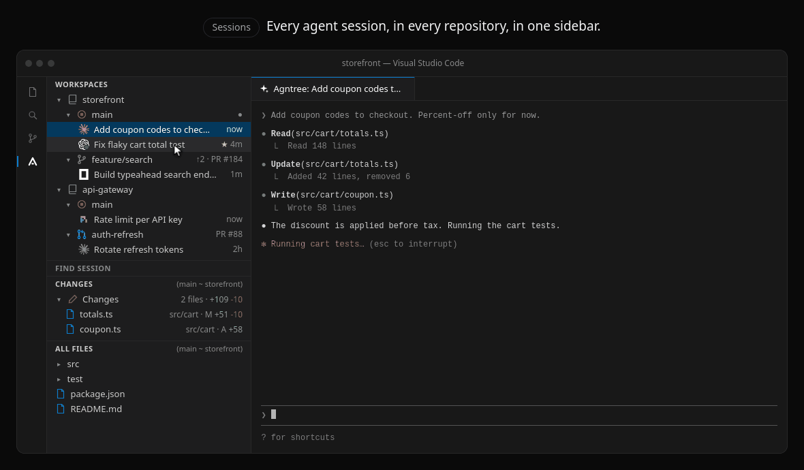
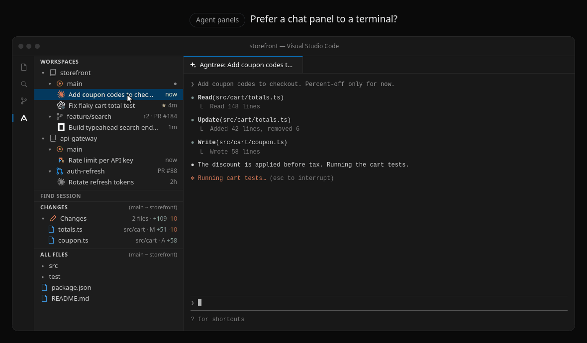
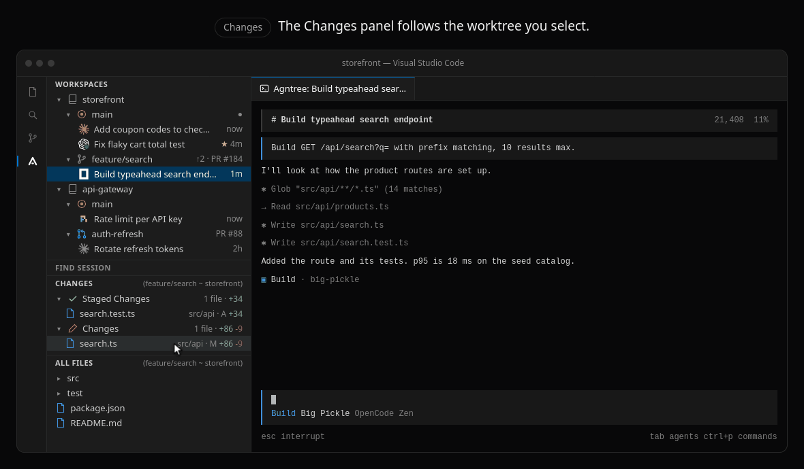
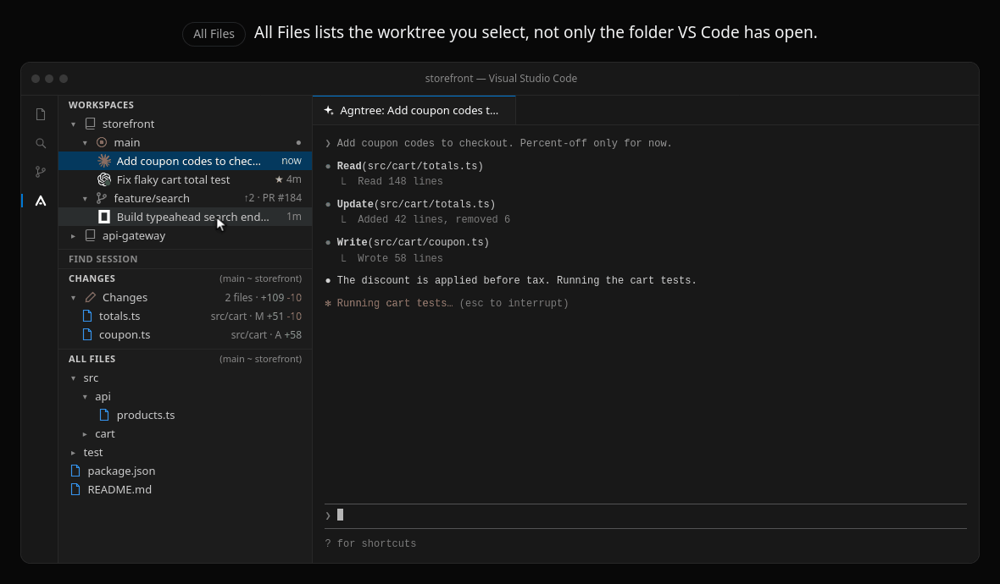
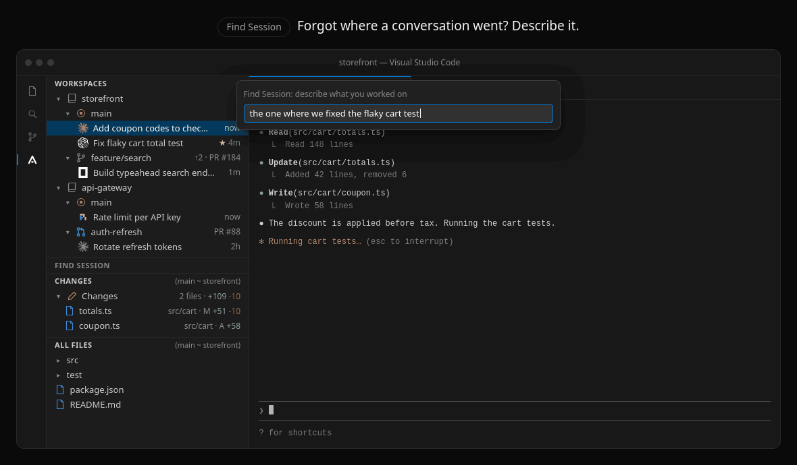
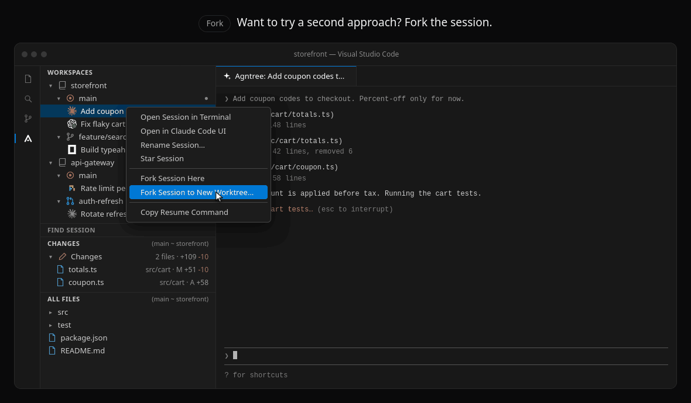
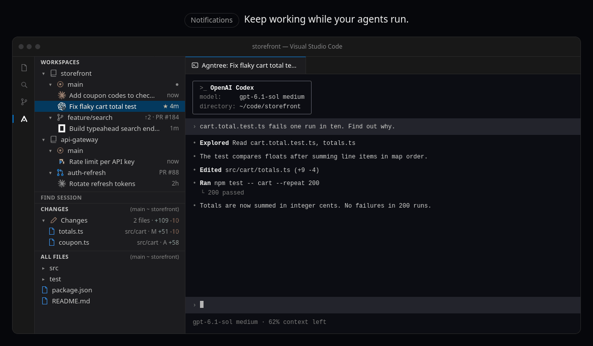
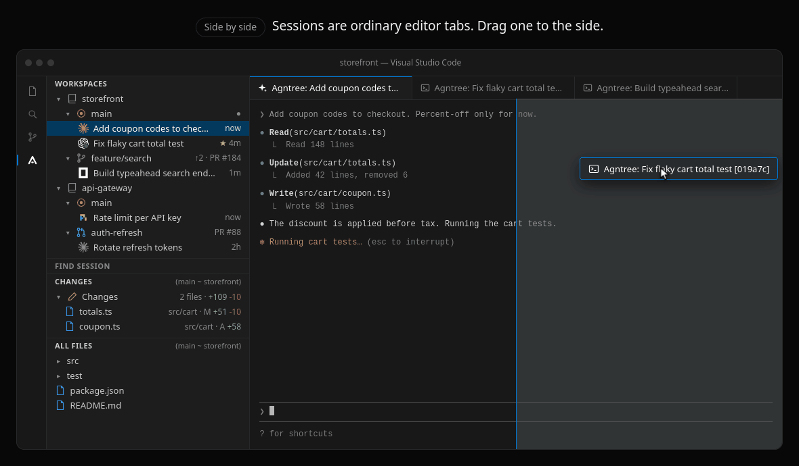
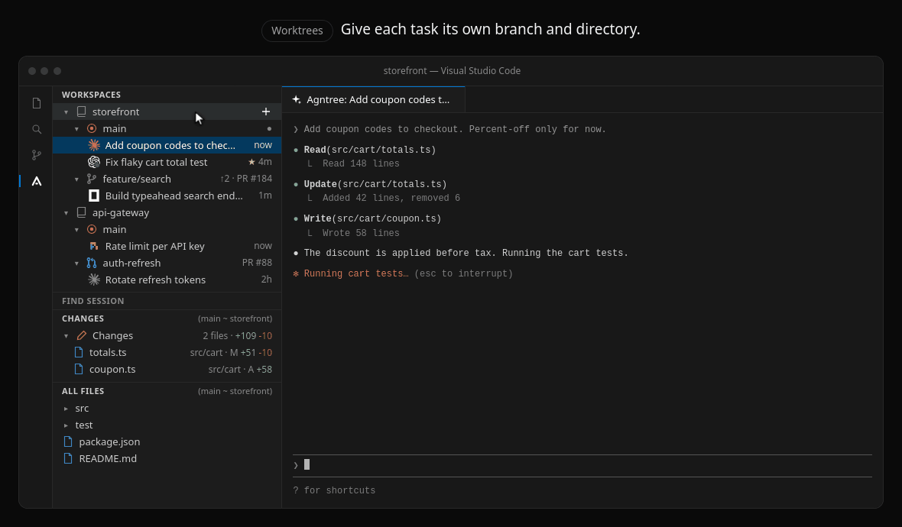

# Pitwall

**Every Claude Code session across your repos, in one sidebar.**

Pitwall is a Cursor / VS Code extension. A sidebar lists every repo and the Claude Code sessions in each one. Every session has a status dot: blue for working, orange for needs you, green for finished, gray for idle. Clicking a session opens it in the official Claude Code extension's chat panel, not a terminal. A Windows pop-up tells you when a session finishes or needs approval, so no session sits waiting while you're in another window.

On an F1 pit wall, the team watches every car at once and calls in whichever one needs attention. Pitwall does that for your agent sessions.

> **Status:** Phase 1. The extension code is imported from Agntree and is being renamed and reorganised. See [ROADMAP.md](ROADMAP.md). <!-- credit-allow -->

Forked from [Agntree](https://github.com/subhashkhileri/agntree) by Subhash Khileri (MIT), at `47124cd`. <!-- credit-allow -->

Pitwall is an independent project, not affiliated with or endorsed by Anthropic. It drives the official Claude Code extension through its public link handler (`vscode://anthropic.claude-code/open`) and never copies or modifies it.

## Setup

**Host (Windows, Git Bash)** requires Python 3.13, Poetry 2.x, Docker Desktop, and Node 22.

```bash
poetry install
cp .env.example .env        # then fill in values
bash scripts/verify.sh
```

On Dropbox, keep dependency folders from syncing: `powershell -ExecutionPolicy Bypass -File scripts\dropbox-ignore.ps1`.

**Windows path-length limit:** with long paths disabled (the Windows default), installs fail with `WinError 206 … filename or extension is too long` when the clone sits deep in the folder tree. Clone to a short path, or enable long paths once from an admin PowerShell:
`Set-ItemProperty HKLM:\SYSTEM\CurrentControlSet\Control\FileSystem -Name LongPathsEnabled -Value 1; git config --system core.longpaths true`

**Container:** in Cursor, run **Dev Containers: Reopen in Container**. It gives you Python 3.13, Node 22 and Poetry 2.3.4, with your `~/.claude/projects` session files mounted read-only. Your Claude login and `.packages/` are deliberately hidden from the container, so install scripts from npm dependencies can't read them.

The container is for building and testing. Pitwall itself runs in Cursor on Windows, because the Claude Code extension, its hooks, and Windows pop-ups all live on the host.

## Layout

| Path | What it is |
|---|---|
| `tools/` | Python dev tooling (Poetry): env checks, session-file probes. Not the extension. |
| `scripts/` | Repeatable commands: `verify.sh`, `run-linux-tests.sh`, `dropbox-ignore.ps1` |
| `.devcontainer/` | Dev container definition |
| `docs/` | Plans and design notes; `docs/adr/` holds upstream's decision records |
| `src/`, `test/`, `package.json` | The extension, imported from Agntree | <!-- credit-allow -->

## Upstream demos

<details>
<summary>What the imported Agntree code looks like (GIFs from upstream; replaced as Pitwall's own UI lands)</summary> <!-- credit-allow -->

 <!-- credit-allow -->
 <!-- credit-allow -->
 <!-- credit-allow -->
 <!-- credit-allow -->
 <!-- credit-allow -->
 <!-- credit-allow -->
 <!-- credit-allow -->
 <!-- credit-allow -->
 <!-- credit-allow -->

</details>

## License

MIT. See [LICENSE](LICENSE) and [THIRD_PARTY_NOTICES.md](THIRD_PARTY_NOTICES.md).
